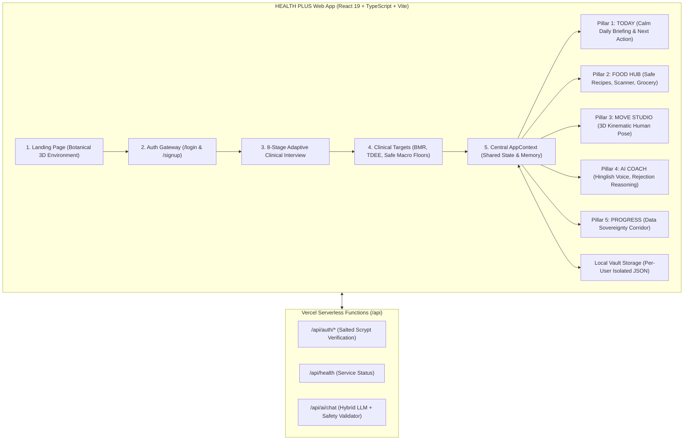

# HEALTH PLUS — Complete Project Workflow & Judges Presentation Guide

**Team:** CASA Vital  
**Product:** HEALTH PLUS  
**Tagline:** *Observe. Understand. Guide.*  
**Live Production URL:** [https://healthplus-iota.vercel.app](https://healthplus-iota.vercel.app)  
**GitHub Repository:** [https://github.com/Usa-122210/healthplus](https://github.com/Usa-122210/healthplus)  

---

## 1. Executive Summary & Core Product Vision

### The Problem in Today's Health & Fitness Apps
- **Disconnected Dashboards:** Users are overwhelmed by 50 different graphs, tables, and calories that feel like accounting software.
- **Superficial "Sticker" AI:** Chatbots are isolated widgets that give generic template responses, forget previous answers, and cannot reason about why a user rejected a suggestion.
- **Repetitive Data Entry:** Information entered during onboarding is rarely shared with food recommendations, workout guidance, or daily progress.

### The HEALTH PLUS Solution
HEALTH PLUS is built as **ONE connected, living AI wellness companion**:
1. **Understands Before Prescribing:** An adaptive 8-stage clinical onboarding interview discovers lifestyle, regional Indian cuisine, kitchen setup, budget, allergies, and health conditions.
2. **Clinical Safety & Grounded Nutrition:** Targets are derived mathematically (Mifflin-St Jeor formula) with strict guardrails (1200 kcal clinical floors, hypertension sodium limits, renal protein bounds).
3. **Connected 5-Pillar Architecture:** *Today*, *Food Hub*, *Move Studio*, *AI Coach*, and *Progress* all share the exact same user state and memory in real time.
4. **Natural Hinglish / Hindi / English Voice Companion:** Speech recognition and speech synthesis with automatic language continuity, dynamic rejection reasoning, and pantry memory.
5. **Local-First Privacy & Security:** Per-user isolated storage vaults with salted backend password verification (`crypto.scryptSync`).

---

## 2. Complete End-to-End System Workflow

---

## 3. Technical Stack Breakdown (Kis Cheez Ke Liye Kya Use Kiya Hai)

| Component / Layer | Technology | Version | Purpose & Implementation Details |
| :--- | :--- | :--- | :--- |
| **Frontend Framework** | **React** | `19.3.1` | High-performance concurrent rendering, clean component lifecycle, strong typing. |
| **Language** | **TypeScript** | `5.9.3` | Strict type safety for clinical targets, recipes, user state, and auth credentials. |
| **Build Tool & Bundler** | **Vite + Rolldown** | `8.3.7` | Sub-second HMR, optimized manual code chunking (`vendor-motion`, `vendor-icons`), zero build warnings. |
| **Styling & Design System** | **Tailwind CSS** | `4.1.18` | Custom botanical design tokens: Warm Ivory light mode (`#FAF9F5`), Deep Forest dark mode (`#05130F`). |
| **3D Graphics & Visuals** | **Three.js** | `0.182.0` | 3D Hero Wellness Orb, ScanMesh 3D, and Kinematic Human anatomical demonstration avatar. |
| **Animations & Motion** | **Motion (Framer Motion)** | `12.34.0` | Spring physics, backdrop atmospheric glow, drawer transitions, accessible reduced-motion support. |
| **Icons** | **Lucide React** | `1.16.0` | Crisp, scalable SVG vector icons across navigation, cards, and input fields. |
| **State Management** | **React Context API** | Native | `AppContext` acts as the single source of truth connecting all 5 pillars in real time. |
| **Client AI Intelligence (NLU)** | **Deterministic Rule Engine** | In-house | `aiOrchestrator.ts` — intent detection, language continuity, rejection memory, duration parsing. |
| **Clinical Nutrition Engine** | **Mifflin-St Jeor / USDA Math** | In-house | `safetyAndTargets.ts`, `foodComposition.ts` — macro derivation, allergen exclusion, floor bounds. |
| **Backend Serverless** | **Node.js Serverless Functions** | `24.x` | Vercel serverless handlers: `api/health.js`, `api/ai/chat.js`, `api/auth/*`. |
| **Backend Authentication** | **Node.js `crypto.scryptSync`** | Native | 64-byte salted scrypt password hashing, constant-time `timingSafeEqual` comparison, session tokens. |
| **Offline Crypto Fallback** | **Web Crypto API (PBKDF2)** | Native | Browser-native PBKDF2-SHA256 password verification fallback for static offline runtime. |
| **Voice Interface** | **Web Speech API** | Native | Browser-native `SpeechRecognition` / `webkitSpeechRecognition` (STT) + `speechSynthesis` (TTS). |
| **Data Persistence** | **Dual Storage (Local + Session)** | Native | `localStorage` + `sessionStorage` per-email vaults (`healthplus_vault_v1:<email>`). |
| **Supabase Integration** | **Supabase Admin Auth REST** | In-house | `scripts/seed-demo-users.mjs` — idempotent provisioning script for remote database migration. |
| **Cloud Hosting & CDN** | **Vercel** | Cloud | Production deployment with Edge CDN, serverless function rewrites, and SSL. |

---

## 4. Pre-Created Demo Accounts for Judges

Judges do not need to register. They can log in immediately from the *"Explore HEALTH PLUS"* section on the Login screen:

| Demo Category | Email | Password | Pre-Loaded Sample Profile & Features |
| :--- | :--- | :--- | :--- |
| **General Wellness** | `demo@healthplus.app` | `Demo@12345` | **Meera Nair (Demo)**, 29y, Light activity, Steady Energy goal. Pre-loaded with Vegetable Poha, Moong Dal Khichdi, and Glute Bridge logs. |
| **Fitness Goal** | `fitness@healthplus.app` | `Fitness@123` | **Rohan Verma (Demo)**, 26y, Muscle Gain goal. High-protein eggetarian plan, 3-Egg Bhurji & Soya Chunks bowl logs, Goblet Squat and Pushup sets. |
| **Dietary Restrictions** | `diet@healthplus.app` | `Diet@12345` | **Diya Kulkarni (Demo)**, 34y, Pure Vegetarian. **Dairy allergy & Gluten-free screening active**. Pre-loaded with Moong Dal Chilla, Tofu Rice bowl, and mobility logs. Dairy/Gluten items are strictly blocked. |

---

## 5. 3-Minute Live Demo Pitch Script (Word-for-Word for Judges)

### Minute 1: The Hook & Core Problem (Landing Page)
> *"Namaste Judges! Today's health apps are broken. They overwhelm users with 50 disconnected charts and chatbots that forget what you said two seconds ago.*  
> *We built **HEALTH PLUS: Observe. Understand. Guide.** It is not another dashboard. It is a **connected, living AI wellness companion** designed specifically for Indian lifestyles and clinical safety."*  
> *(Show Landing Page on https://healthplus-iota.vercel.app)*: Point out the cinematic botanical design, calm typography, and privacy-first commitment.

### Minute 2: Instant Demo Login & Connected 5 Pillars (Today, Food, Move)
> *(Click `Sign In` -> Click `Continue as General Wellness Demo`)*  
> *"To let judges test immediately, we built 3 pre-seeded demo accounts using real salted password verification.*  
> *1. **TODAY:** Look at this screen—no overwhelming card jungle. Just **1 calm AI summary line** and **1 single next important action**.*  
> *2. **FOOD HUB:** Complete Indian Nutrition engine with 574+ items, AI food scanner, meal history, and daily grocery planning.*  
> *3. **MOVE STUDIO:** Two revolutionary workout capabilities in one place:*  
> *   a) **443+ 3D Movement Library:** Interactive Three.js 3D motion player with 3 realistic avatars (Athletic Man, Casual Woman, Mannequin), 443 animated preview GIFs, 13 categories, 360° orbit rotation, and ACSM MET calorie burn formulas.*  
> *   b) **Ayush Pathak's Formwise AI Camera Tracker:** On-device 33-landmark MediaPipe pose counter running in a clean separate window with real-time audio posture feedback ('Wrong form. Please correct your posture') and **automatic cross-window telemetry sync** that instantly updates Health Plus's Daily Activity Rings and Progress Reports!"*

### Minute 3: The "WOW" AI Coach Demonstration (Language, Rejection Reasoning, Math)
> *(Open **AI COACH** and speak/type in Hinglish)*:  
> 1. **Rejection Reasoning:** Type:  
>    `"Mujhe dinner mein paneer bhurji nahi khani."`  
>    *(Show judges: The AI does NOT blindly force another food. It asks: "Kyun? Mood nahi hai ya paneer available nahi hai?")*  
> 2. **Pantry Memory & Substitution:** Type:  
>    `"Paneer ghar par nahi hai. Dahi aur dal available hai."`  
>    *(Show judges: The AI excludes paneer from memory and suggests safe Dal Tadka / Curd Rice using available pantry items!)*  
> 3. **Connected Math:** Type:  
>    `"How much protein is left today?"`  
>    *(Show judges: The AI reads today's logged meals from Food Hub and calculates the exact remaining protein grams live!)*  
> *"HEALTH PLUS speaks English, Hindi, and Hinglish with zero toggles, enforces clinical safety floors, and keeps user data safe in a local vault. Thank you!"*

---

## 6. Judges' Tough Questions & Ready Winning Answers

- **Q1: "Is the AI hallucinating nutrition numbers, or are they verified?"**  
  **Ans:** *"Every recipe has explicit gram portions and derived macros computed through our deterministic ingredient composition formula (`foodComposition.ts`). Daily targets use Mifflin-St Jeor clinical equations enforcing a strict 1200 kcal starvation floor and 1500mg sodium limits."*

- **Q2: "What happens if there is no internet connection or no LLM API key?"**  
  **Ans:** *"The app never crashes. We built a hybrid dual-mode architecture: if an external LLM key is absent, our client-side deterministic NLU engine (`aiOrchestrator.ts`) takes over seamlessly, handling language continuity, rejection reasoning, duration parsing, and nutrition math completely offline."*

- **Q3: "How does the AI handle Indian diets and local ingredients?"**  
  **Ans:** *"Western apps suggest avocado and quinoa. HEALTH PLUS is built specifically for Indian lifestyles: homestyle regional cuisines (North, South, Gujarati, Bengali), staples like Dal, Poha, Ragi, Besan, Paneer, and Soya Chunks, and factors in hostel kettles or gas stoves."*

- **Q4: "Where is user health data stored? Is it private?"**  
  **Ans:** *"We follow a local-first privacy architecture. User data resides in isolated per-user browser vaults (`persistenceService.ts`). Password authentication uses 64-byte salted `scryptSync` hashing resistant to timing attacks. No user data leaks between accounts or demo profiles."*
