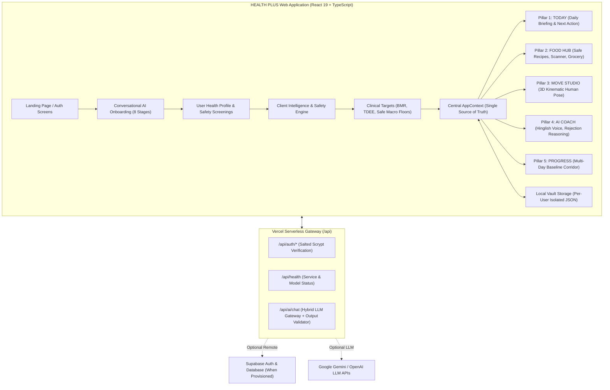
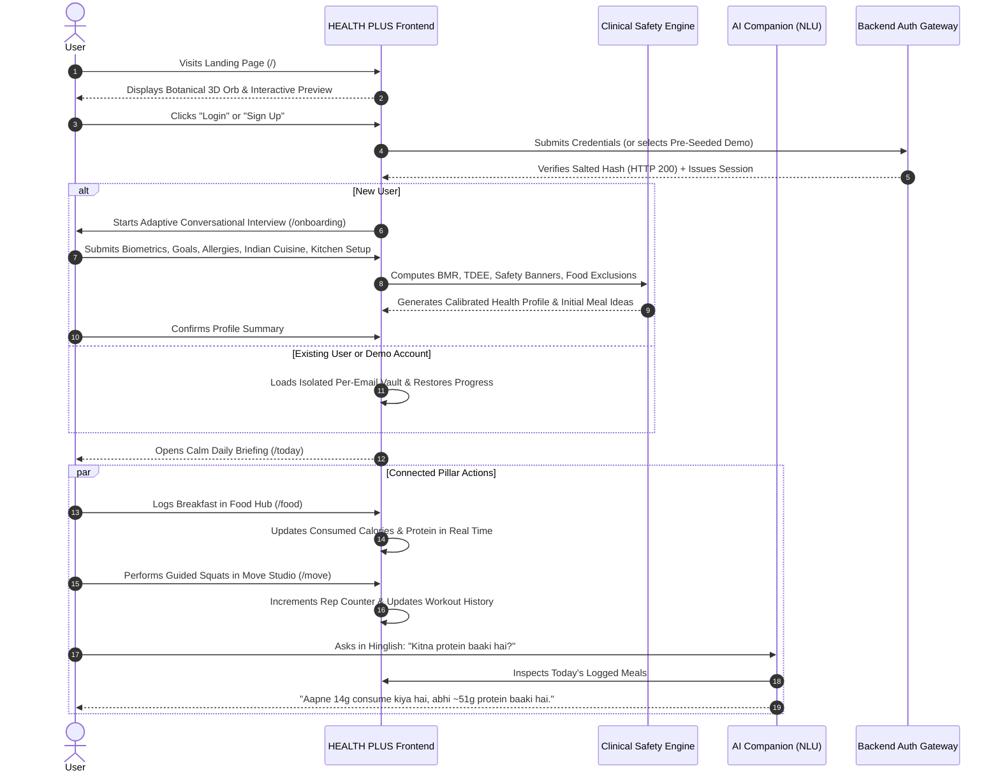

# HEALTH PLUS — Complete Architecture, Workflow & Judges Presentation Guide

**Team:** CASA Vital  
**Product:** HEALTH PLUS  
**Tagline:** *Observe. Understand. Guide.*  
**Live Production URL:** [https://healthplus-iota.vercel.app](https://healthplus-iota.vercel.app)  
**GitHub Repository:** [https://github.com/Usa-122210/healthplus](https://github.com/Usa-122210/healthplus)  

---

## 1. Executive Summary & Core Product Vision

### The Core Problem in Modern Health Tech
Most fitness and health applications suffer from **fragmentation and superficial AI**:
- They show dozens of disconnected cards, static calorie counters, and complex dashboard graphs that overwhelm the user.
- Chatbots are slapped on as isolated widgets that give generic, template advice and forget previous answers.
- When a user rejects a food recommendation (e.g., *"I don't have paneer at home"*), typical apps repeat the same suggestion or fail to understand the reason.
- User data is scattered across multiple pages, forcing users to re-enter information repeatedly.

### The HEALTH PLUS Solution
HEALTH PLUS is designed as **ONE connected, living AI personal wellness companion**:
1. **Understands Before Prescribing:** The AI interviews the user through an 8-stage adaptive onboarding conversation to understand lifestyle, kitchen setup, budget, allergies, and health conditions before generating recommendations.
2. **Clinical Safety & Grounded Nutrition:** Every calorie, macro, and workout recommendation is grounded in verified clinical formulas (Mifflin-St Jeor BMR, TDEE, 1200 kcal clinical floors, hypertension sodium limits, renal protein bounds).
3. **5 Connected Pillars:** *Today*, *Food Hub*, *Move Studio*, *AI Coach*, and *Progress* all share the exact same user state and memory in real time.
4. **Natural Hinglish/Hindi/English Voice Companion:** A voice-enabled conversational assistant that maintains language continuity, reasons about food rejections, and remembers ingredient availability across turns.
5. **Local-First Privacy & Security:** User data resides in a secure, isolated local browser vault with salted server-side authentication (`scryptSync`).

---

## 2. System Architecture & High-Level Data Flow

---

## 3. Complete Step-by-Step User Journey & Workflow

### Detailed Breakdown of Every Step:

### Step 1: Public Landing Page (`/`)
- **Atmosphere:** Deep Forest Green (`#05130F`) and Warm Ivory (`#FAF9F5`) botanical color palette, free of generic SaaS dashboard clutter.
- **Interactive Companion Preview:** Prospective users can interact with an inline interactive demo without registering to see how the AI communicates.
- **Clear Trust Signals:** Explicit non-diagnostic wellness positioning, medical referral boundaries, and local data sovereignty disclosures.

### Step 2: Authentication & Security (`/login`, `/signup`)
- **Separation:** Dedicated `/login` and `/signup` routes with smooth navigation links.
- **Field & Password Controls:** Full name, email format validation, `PasswordInput` with an eye show/hide toggle, password confirmation match, and a mandatory Terms & Privacy consent checkbox.
- **3 Pre-Created Demo Accounts:** Direct one-click login buttons under *"Explore HEALTH PLUS"* allowing judges and developers to test the product without registering:
  1. **General Wellness:** `demo@healthplus.app` / `Demo@12345` (Meera Nair — balanced steady energy baseline, logged meals & mobility).
  2. **Fitness Goal:** `fitness@healthplus.app` / `Fitness@123` (Rohan Verma — muscle gain, high protein, bodyweight & dumbbell workouts).
  3. **Dietary Restrictions:** `diet@healthplus.app` / `Diet@12345` (Diya Kulkarni — vegetarian, dairy-free & gluten-free allergy screening).
- **Route Guarding:** Direct navigation to protected routes (`/today`, `/food`, `/move`, `/coach`, `/progress`, `/profile`, `/settings`, `/onboarding`) without active authentication automatically redirects to `/login` with an informational notice.

### Step 3: Conversational AI Onboarding (`/onboarding`)
An 8-stage interactive interview that adapts to prior answers:
1. **Welcome & Philosophy:** Explains the continuous observation approach.
2. **Biometrics:** Age, gender, height, current weight, target weight (empty biometrics prevent accidental skip).
3. **Primary Goal Selection:** Steady Energy / Fat Loss / Muscle Gain / Metabolic Health.
4. **Health Safety & Conditions Screening:** Allergy checks (Dairy, Peanuts, Tree Nuts, Gluten, Eggs, Soy, Shellfish, Sesame). Conditional follow-up: enabling *Blood Sugar / Diabetes Concern* automatically unlocks an in-depth follow-up question (*Diet-guided habits* vs *Under medical supervision*).
5. **Food Preferences & Indian Cuisine:** Homestyle Pan-Indian, North, South, Gujarati/Marathi, or Bengali regional choices + Budget tier (Budget / Moderate / Flexible) + Cooking time limit.
6. **Exercise Equipment & Experience:** Home bodyweight, dumbbells/resistance bands, yoga mat, or gym access + preferred session duration.
7. **Pantry Availability Check:** Checks kitchen staples. If the user selected *Vegetarian*, non-vegetarian items (Chicken, Eggs) are automatically filtered out.
8. **Explicit Confirmation Summary:** Displays a clean card summarizing all collected data before the user commits to generating their plan.

### Step 4: Clinical Targets Calculation
The mathematical engine calculates personalized baseline targets:
$$\text{BMR (Men)} = 10 \times \text{weight (kg)} + 6.25 \times \text{height (cm)} - 5 \times \text{age} + 5$$
$$\text{BMR (Women)} = 10 \times \text{weight (kg)} + 6.25 \times \text{height (cm)} - 5 \times \text{age} - 161$$
$$\text{TDEE} = \text{BMR} \times \text{Activity Multiplier}$$
- **Clinical Floor:** Deficit calculations are hard-bounded to $\ge 1200\text{ kcal/day}$ to prevent malnutrition.
- **Hypertension Bounds:** Sodium ceiling restricted to $\le 1500\text{ mg/day}$.
- **Renal Guardrail:** Daily protein restricted to safe kidney bounds ($\sim 0.85\text{ g/kg}$).

### Step 5: The 5 Connected Daily Pillars

#### Pillar 1: TODAY (`/today`)
- **Single AI Summary Line:** A calm greeting and one grounded summary of today's status (e.g. *"You've logged 1 meal (~485 kcal, 20g protein) and 12 guided reps today — steady rhythm toward your steady energy focus."*).
- **One Next Clear Action:** Subah meal idea suggest karega, workout ke time Move Studio, aur shaam ko evening AI Coach check-in.
- **Quick Hydration Tracker:** Single-click water intake logger (+0.25L, -0.25L).
- **Consistency Streak Counter:** Consecutive days of active logging.

#### Pillar 2: FOOD HUB (`/food`)
- **14+ Verified Indian Recipes Catalog:** Reference recipes (Moong Dal Khichdi, Palak Paneer, Vegetable Poha, Moong Dal Chilla, Soya Chunks Rice Bowl, etc.) with ingredient-level macro breakdown.
- **Smart Scoring Engine:** Filters recipes strictly against user allergies (e.g., dairy or gluten), available kitchen equipment, and pantry ingredients.
- **Daily Plan & Grocery Checklist:** Pre-computes a safe 4-slot daily Indian meal plan (Breakfast, Lunch, Snack, Dinner) and lists missing ingredients as a smart shopping list.
- **Meal Diary:** One-click meal logging updating daily consumed totals.

#### Pillar 3: MOVE STUDIO (`/move`)
- **3D Kinematic Human Avatar:** An interactive Three.js animated human wireframe performing exercises with realistic joint articulation.
- **Exercise Suite:** Bodyweight Squats, Pushups, and Glute Bridges.
- **Biomechanics Coaching Cues:** Visual and voice cues (e.g., *"Knees track over toes"*, *"Spine stays neutral"*).
- **Rep Counter & Logging:** Rapid rep increments with stale-closure protection and local workout session history.

#### Pillar 4: AI COACH (`/coach`)
- **Persistent Companion:** Accessible both as a floating orb on every page and as a full-screen dedicated studio.
- **Language Continuity:** Automatically detects whether the user speaks English, Hindi, or Hinglish, and sticks to that language naturally without making the user choose from a dropdown.
- **Rejection Reasoning:** If a user rejects a dish (*"Mujhe dinner mein paneer bhurji nahi khani"*), the AI asks *why* (taste, mood, or unavailable ingredient).
- **Ingredient Negation & Substitution:** If the user replies *"Paneer nahi hai"*, the AI marks paneer as unavailable in memory and suggests alternatives using available pantry items (e.g., Dal Tadka or Curd Rice).
- **Connected Math:** If the user asks *"How much protein is left today?"*, it computes:
  $$\text{Remaining Protein} = \text{Target Protein} - \sum \text{Logged Protein Today}$$
- **Voice STT & TTS:** Microphone input + speech synthesis audio playback with speed controls (0.85x, 1.0x, 1.15x).

#### Pillar 5: PROGRESS & DATA SOVEREIGNTY (`/progress`)
- **Multi-Day Health Corridor:** Daily calorie trend line, protein intake bar chart, and recorded workout repetitions.
- **Real Averages:** Live-computed average recorded kcal, protein, and total completed reps.
- **Data Sovereignty:** Single-click data export and reset controls.

---

## 4. Technical Stack & Implementation Breakdown

| Component / Layer | Technology | Version | Purpose & Implementation |
| :--- | :--- | :--- | :--- |
| **Frontend Framework** | **React** | `19.3.1` | Concurrent rendering, modern hooks (`useRef`, `useMemo`, `useState`), zero UI blocking. |
| **Programming Language** | **TypeScript** | `5.9.3` | Strict type safety across clinical targets, nutrition profiles, and auth states. |
| **Build Tool & Bundler** | **Vite + Rolldown** | `8.3.7` | Sub-second HMR, optimized code splitting (`vendor-motion`, `vendor-icons`), zero build warnings. |
| **Styling & Design System** | **Tailwind CSS** | `4.1.18` | Modern CSS variables, Warm Ivory light mode (`#FAF9F5`) and Deep Forest dark mode (`#05130F`). |
| **3D Graphics & Physics** | **Three.js** | `0.182.0` | 3D Hero Wellness Orb, ScanMesh 3D, and Kinematic Human anatomical demonstration avatar. |
| **Animations & Motion** | **Motion (Framer Motion)** | `12.34.0` | Spring physics, backdrop atmospheric glow, drawer transitions, accessible reduced-motion support. |
| **Icons** | **Lucide React** | `1.16.0` | Crisp, scalable SVG iconography across navigation, actions, and status badges. |
| **Client State Management** | **React Context API** | Custom | `AppContext` acts as the single source of truth connecting all 5 pillars in real time. |
| **Client AI Intelligence (NLU)** | **Deterministic Rule Engine** | In-house | `aiOrchestrator.ts` — intent classification, entity parsing, language continuity, rejection memory. |
| **Clinical Nutrition Engine** | **Mifflin-St Jeor / USDA Math** | In-house | `safetyAndTargets.ts`, `foodComposition.ts` — macro derivation, allergen exclusion, floor bounds. |
| **Backend Serverless Functions**| **Node.js** | `24.x` | Vercel serverless handlers: `api/health.js`, `api/ai/chat.js`, `api/auth/*`. |
| **Backend Authentication** | **Node.js `crypto.scryptSync`**| Native | 64-byte salted scrypt password hashing, constant-time `timingSafeEqual` comparison, session tokens. |
| **Offline Crypto Mirror** | **Web Crypto API (PBKDF2)** | Native | Browser-native PBKDF2-SHA256 password verification fallback for static offline runtime. |
| **Voice Interface** | **Web Speech API** | Native | Browser-native `SpeechRecognition` / `webkitSpeechRecognition` (STT) + `speechSynthesis` (TTS). |
| **Data Persistence** | **Dual Storage (Local + Session)**| Native | `localStorage` + `sessionStorage` per-email vaults (`healthplus_vault_v1:<email>`). |
| **Supabase Integration** | **Supabase Admin Auth REST** | In-house | `scripts/seed-demo-users.mjs` — idempotent provisioning script for remote database migration. |
| **Cloud Hosting & CDN** | **Vercel** | Cloud | Production deployment with Edge CDN, serverless function rewrites, and SSL. |

---

## 5. Pre-Created Demo Accounts for Judges

To allow judges and evaluators to test the full system without registering:

| Demo Category | Email | Password | Pre-Loaded Sample Profile & Features |
| :--- | :--- | :--- | :--- |
| **General Wellness** | `demo@healthplus.app` | `Demo@12345` | **Meera Nair (Demo)**, 29y, Light activity, Steady Energy goal. Pre-loaded with Vegetable Poha, Moong Dal Khichdi, and Glute Bridge logs. Demonstrates calm daily pacing. |
| **Fitness Goal** | `fitness@healthplus.app` | `Fitness@123` | **Rohan Verma (Demo)**, 26y, Muscle Gain goal. High-protein eggetarian plan, 3-Egg Bhurji & Soya Chunks bowl logs, Goblet Squat and Pushup sets. |
| **Dietary Restrictions** | `diet@healthplus.app` | `Diet@12345` | **Diya Kulkarni (Demo)**, 34y, Pure Vegetarian. **Dairy allergy & Gluten-free screening active**. Pre-loaded with Moong Dal Chilla, Tofu Rice bowl, and mobility logs. Dairy/Gluten items are strictly blocked. |

> **Key Judge Note:** Demo accounts pass **real salted authentication** through `api/auth/login`. They are NOT mock bypass buttons. Furthermore, demo accounts display an explicit **"Demonstration Data"** top banner and are strictly isolated from personal user accounts.

---

## 6. Three-Minute Live Demo Pitch Script (For Presenting to Judges)

Use this step-by-step presentation script to impress judges in 3 minutes:

### Minute 1: The Hook & Core Problem (Landing Page)
- *"Namaste judges! Most health apps today are disconnected dashboards full of random charts that leave you overwhelmed, or chatbots that give generic template answers and forget what you said 2 seconds ago."*
- *"We built **HEALTH PLUS: Observe. Understand. Guide.** It is not another dashboard. It is a connected, living AI wellness companion."*
- *(Show Landing Page on [healthplus-iota.vercel.app](https://healthplus-iota.vercel.app))*: Point out the cinematic botanical design, calm typography, and privacy-first commitment.

### Minute 2: Instant Demo Login & The Connected Experience (Today, Food, Move)
- *"Let's log in. Instead of forcing you to register, we built 3 real pre-seeded demo accounts."*
- *(Click `Sign In` -> Click `Continue as General Wellness Demo`)*:
  - *"Notice we authenticate via real salted scrypt hashing. The top banner clearly marks this as Demonstration Data."*
- *"Look at the **TODAY** screen: There are no dozens of overwhelming cards. There is 1 calm AI summary line, and 1 single next important action."*
- *(Navigate to **FOOD HUB**)*:
  - *"Here are verified Indian recipes tailored to Meera's kitchen. Notice the 'Daily Plan & Grocery' tab—it generates a safe 4-slot Indian meal plan and lists missing groceries."*
- *(Navigate to **MOVE STUDIO**)*:
  - *"In Move Studio, we have an interactive 3D kinematic human avatar demonstrating squats with real biomechanics cues, paired with an instant rep counter."*

### Minute 3: The "Wow" AI Coach Demonstration (Language, Rejection Reasoning, Math)
- *(Open **AI COACH**)*:
  - **Turn 1 (Rejection Reasoning):** Type or speak in Hinglish:  
    *`"Mujhe dinner mein paneer bhurji nahi khani."`*  
    *Show judges:* The AI does NOT blindly suggest another random food. It asks: *"Kyun? Mood nahi hai ya paneer available nahi hai?"*
  - **Turn 2 (Ingredient Negation & Memory):** Type:  
    *`"Paneer ghar par nahi hai. Dahi aur dal available hai."`*  
    *Show judges:* The AI excludes paneer from its memory, respects the user's kitchen, and suggests safe Dal Tadka / Curd Rice.
  - **Turn 3 (Connected Math):** Type:  
    *`"How much protein is left today?"`*  
    *Show judges:* The AI looks at today's logged meals in the Food Hub and computes the exact remaining grams of protein live!
- *"HEALTH PLUS works in English, Hindi, and Hinglish with zero dropdown toggles, respects clinical safety floors, and stores user data securely in a local vault. Thank you!"*

---

## 7. Frequently Asked Judge Questions & Winning Answers

#### Q1: "Is the AI hallucinating nutrition numbers, or are they verified?"
> **Answer:**  
> *"No hallucinations. Every recipe in our catalog has explicit gram portions and derived macros computed through our deterministic ingredient composition formula (`foodComposition.ts`). Furthermore, all daily targets are bounded by Mifflin-St Jeor clinical equations, enforcing a strict 1200 kcal floor to prevent starvation deficits and bounding sodium for hypertension."*

#### Q2: "How does the AI handle Indian diets and local ingredients?"
> **Answer:**  
> *"Unlike Western apps that suggest kale and quinoa, HEALTH PLUS is built specifically for Indian lifestyles. It features homestyle regional Indian cuisines (North, South, Gujarati/Marathi, Bengali), understands local staples like Dal, Poha, Ragi, Besan, Soya Chunks, and Paneer, and factors in kitchen setups like basic gas stoves or hostel kettles."*

#### Q3: "What happens if there is no internet connection or no LLM API key?"
> **Answer:**  
> *"The app has zero downtime. We built a hybrid dual-mode architecture: if an external LLM key is absent or unreachable, our client-side deterministic NLU engine (`aiOrchestrator.ts`) takes over seamlessly. It handles language detection, rejection reasoning, duration parsing, and nutrition math completely offline."*

#### Q4: "Where is user health data stored? Is it private?"
> **Answer:**  
> *"We follow a local-first privacy architecture. User health data and meal logs reside in isolated per-user browser vaults (`persistenceService.ts`). Password authentication uses 64-byte salted `scryptSync` hashing resistant to timing attacks. No user data leaks between accounts or demo profiles."*

---

**HEALTH PLUS — Observe. Understand. Guide.**
